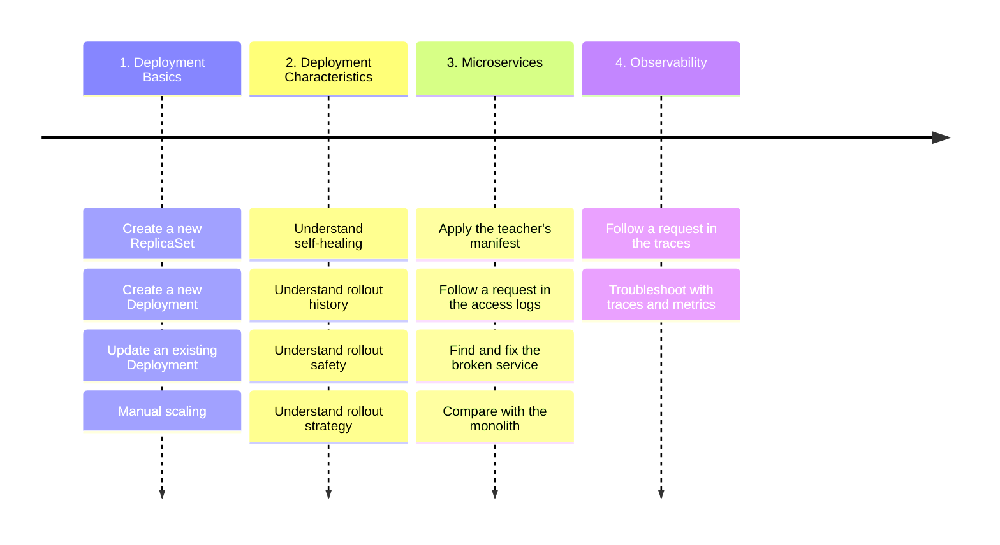

# Kubernetes Deployment

Lab Session 3 - 28 Oct, 2026

## Introduction

The goal of this lab session is to train your skills related to
ReplicaSet and Deployment. It lets you practice the definition,
creation, operations related to these resources, lets you better
understand their characteristics. This session is also a transition
toward a bigger project “Pet Clinic” using a microservice architecture.



## Before you start - Delete the Pods of Lab 2

The Pods of Lab Session 2 may still run in your cluster: `nginx`,
`spring-petclinic` and `team-info-server`. Delete them, so that this lab
session starts from an empty namespace.

``` sh
kubectl delete pod nginx spring-petclinic team-info-server --ignore-not-found
kubectl get pods
# No resources found in default namespace.
```

  

## Exercise 1 - ReplicaSet

Create a new ReplicaSet with 1 replica and the Docker image
“spring-petclinic” that you developed in Lab Session 1. Use labels
`app=spring-petclinic` and `team=${team}` for both the ReplicaSet and
the underlying Pods. The underlying container should use port 8080 to
receive incoming traffic. The container name should be `main` in the
ReplicaSet. Please don’t use the local image; instead, you should use
the Docker Image published to Docker Hub. Persist the Kubernetes
manifest (YAML file) in the Git repository as file
`k8s/lab-3/replicaset-petclinic.yaml`.

  

``` sh
# NOTE: write the manifest to file "${REPO_ROOT}/k8s/lab-3/replicaset-petclinic.yaml"
```

  

Now, scale the ReplicaSet to 2 replicas and verify that the operation is
successful.

  

``` sh
# TODO: write down your command and verification here
```

  

Delete one of the Pods from this ReplicaSet, how many Pods do you have
now? Why?

  

``` sh
# TODO: write down your verification and analysis here
```

  

Now, delete the ReplicaSet to free up space on your machine.

  

``` sh
# TODO: write down your command and verification here
```

  

## Exercise 2 - Deployment

Similar to Exercise 1, create a new Deployment with 1 replica using the
Docker image “spring-petclinic”. Use labels `app=spring-petclinic` and
`team=${team}` for both the Deployment and the underlying Pods. The
underlying container should use port 8080 to receive incoming traffic.
The container name should be `main` in the Deployment. Persist the
Kubernetes manifest (YAML file) in the Git repository as file
`k8s/lab-3/deployment-petclinic.yaml`.

  

``` sh
# NOTE: write the manifest to file "${REPO_ROOT}/k8s/lab-3/deployment-petclinic.yaml"
```

  

Update the Deployment to include your team name as an environment
variable. The key should be `TEAM`, and the value should be your team
name in lowercase.

Once the change is applied, describe it in a few words, as you do for a
commit in Git. The description goes to the annotation
`kubernetes.io/change-cause` of the Deployment:

``` sh
kubectl annotate deployment/spring-petclinic kubernetes.io/change-cause="Add the environment variable TEAM"
```

Observe the rollout history of the Deployment: how many revisions does
it have, and what does it say about each of them?

  

``` sh
# NOTE: write the manifest to file "${REPO_ROOT}/k8s/lab-3/deployment-petclinic.yaml"
```

``` sh
# TODO: write down your commands and the rollout history here
```

  

Try to disrupt the Deployment by using a Docker image tag that does not
exist, then describe this change as well, with the same annotation. What
happens? Consider checking the ReplicaSets related to this Deployment.
Can you access the website from your browser?

  

``` sh
# TODO: write down your analysis
```

  

Can you roll back to the previous version? Observe the rollout history
before and after the rollback: what changed?

  

``` sh
# TODO: write down your commands and your observations here
```

  

## Exercise 3 - Deployment Strategy

When a Deployment rolls out a new version, its strategy says how the
Pods are replaced. So far, your Deployment used the default one. Now,
change it: add the following block to the `spec` of the Deployment, at
the same level as `replicas`, and apply the manifest.

``` yaml
strategy:
  type: RollingUpdate
  rollingUpdate:
    maxSurge: 0%
    maxUnavailable: 100%
```

Both values are a percentage of the replicas. `maxSurge` is the number
of Pods that a rollout can add to them, and `maxUnavailable` is the
number of Pods that can be unavailable during a rollout. Here, a rollout
cannot add any Pod, and all the Pods can be unavailable. See more
information about the strategy at
https://kubernetes.io/docs/concepts/workloads/controllers/deployment/#strategy

Then, disrupt the Deployment again by using a Docker image tag that does
not exist, and describe this change afterward, as in Exercise 2. What
happens this time? Can you access the website from your browser? Compare
with the previous disruption and explain the difference. Finally, roll
back to the previous version.

  

``` sh
# NOTE: write the strategy to file "${REPO_ROOT}/k8s/lab-3/deployment-petclinic.yaml"
# TODO: write down your commands and your analysis here
```

  

## Exercise 4 - Microservices

Now, the Pet Clinic grows: it is no longer one application, it adopts a
microservice architecture. The API Gateway serves the Web UI and routes
the requests to three services: the Customers Service, the Visits
Service and the Veterinarians Service. Each of them runs as its own
Deployment.

Keep the Deployment `spring-petclinic` of Exercise 3 running: at the end
of this exercise, you compare the two architectures. Stop its
port-forward, though, if it still runs: the API Gateway takes the same
local port.

The teacher prepared the manifest of the whole stack. Apply it:

``` sh
kubectl apply -f https://mincong.io/esigelec/lab/3/microservices.yaml
```

Give the stack a minute or two to start, then open the website
(<http://localhost:8080>) in your browser:

``` sh
kubectl port-forward deployment/api-gateway 8080:8080
```

Is the website loaded correctly? Please take a screenshot and store it
in this git repo as file `docs/lab-3/website.png`.

Unfortunately, this manifest has one mistake, and the website is
half-broken. Visit the pages of the website: which ones work, and which
one fails? Don’t consider the page “About” nor the chat box “Chat with
Us!”: they show an error until Lab Sessions 4 and 5.

  

``` sh
# NOTE: store the screenshot as file "${REPO_ROOT}/docs/lab-3/website.png"
# TODO: write down your observations here
```

  

Before you look for the mistake, follow a request through the stack.
Each service writes an **access log**: one line for each HTTP request
that it receives, in the logs of its container. Each of these lines
contains the word `AccessLog`: to see them only, filter the logs of a
Deployment, and follow them with `-f` while you click in the website.
Stop with `Ctrl+C`. For example, for the API Gateway:

``` sh
# Linux, macOS, Git Bash
kubectl logs deployment/api-gateway -f | grep AccessLog
# PowerShell
kubectl logs deployment/api-gateway -f | Select-String AccessLog
```

Replace `api-gateway` with the name of another Deployment to read its
access log. Open the page “Find owners”, then find the line of this
request in the access log of the API Gateway, and in the access log of
the service that answered it. What differs between the two lines, and
why? Then do the same for the page “Veterinarians”: what do you find,
and what is missing?

  

``` sh
# TODO: write down your commands, the lines that you found and your analysis here
```

  

Now, look further into the Deployment of the Veterinarians Service, its
Pod and its image: what went wrong?

  

``` sh
# TODO: write down your commands and your analysis here
```

  

Fix the mistake: save the teacher’s manifest in the Git repository as
file `k8s/lab-3/microservices.yaml`, correct it there and apply it. Then
go through the whole flow again: open the page “Veterinarians”, and
follow its request in the access logs of the API Gateway and of the
Veterinarians Service. Prove that the veterinarians are returned now.

  

``` sh
# NOTE: write the fixed manifest to file "${REPO_ROOT}/k8s/lab-3/microservices.yaml"
# TODO: write down your commands and your verification here
```

  

Now that the whole website works, compare the two architectures of the
Pet Clinic: the monolith of Exercises 2 and 3, which is the Deployment
`spring-petclinic`, and the microservices. First, install the
observability tools of the Pet Clinic. One of them is the Metrics
Server, an add-on of Kubernetes that measures the CPU and the memory
that each Pod uses; the three others are for Exercise 5. Together, they
take about 500 MB of memory: if your machine runs short of it, tell the
teacher. Wait a minute for the first measures, then read them:

``` sh
kubectl apply -f https://mincong.io/esigelec/lab/3/observability.yaml
kubectl top pod
```

The Pods `tracing-server`, `prometheus-server` and `grafana-server` are
the tools of Exercise 5: they belong to neither architecture, so leave
them out of the comparison.

Then explore the two architectures, and gather the facts that tell them
apart, with how you found each of them. For example: the resources and
the images that each one needs, the memory and the CPU that its Pods
use, the time that an application takes to start, or what the users saw
when an image was broken. Everything is at hand: the manifests, the
access logs, and the commands `kubectl get`, `kubectl describe`,
`kubectl logs` and `kubectl top`.

  

``` sh
# TODO: write down the facts that you gathered, and how you found each of them
```

  

Finally, put yourself in the shoes of a software architect. Your company
has hundreds of developers, and its main product is one application,
built and rolled out as a whole, like the monolith of the Pet Clinic.
Some teams ask to split it into microservices. Is it worth it?

Write one or two paragraphs to defend your position, with the facts that
you gathered. There is no standard answer: what counts is the number of
points of view that you consider, and how far you think each of them
through. For example: who owns a service, and who is called when it
fails? How does a team roll out a new version? What can be scaled, and
at what cost? What happens to the users when one part fails? And what is
the price to pay, for the machines and for the people?

  

``` sh
# TODO: write down your position here, in one or two paragraphs
```

  

## Exercise 5 - Microservices Observability

The access logs say what each service received, one service at a time.
**Observability** tools say more: a **trace** follows one request
through all the services, with the time of each step, and the
**metrics** measure the services over time, such as their number of
requests per second. This exercise uses three of these tools, which run
since you applied `observability.yaml` in Exercise 4:

- The **Tracing Server**, [Zipkin](https://zipkin.io/), collects the
  traces that the services send.
- [Prometheus](https://prometheus.io/) collects the metrics of the
  services, every 15 seconds.
- [Grafana](https://grafana.com/) draws these metrics in dashboards.

If your machine runs short of memory, delete the monolith, which
Exercise 4 no longer needs:
`kubectl delete deployment/spring-petclinic`.

The services do not send their traces yet. In your manifest
`k8s/lab-3/microservices.yaml`, enable them: in the ConfigMap
`petclinic-config`, under `tracing` and `export`, change
`enabled: false` into `enabled: true`. Apply the manifest, then restart
the four PetClinic services, so that they read their new configuration:

``` sh
kubectl rollout restart deployment/api-gateway deployment/customers-service deployment/visits-service deployment/vets-service
```

Why does a change of the ConfigMap need a restart of the Deployments?

  

``` sh
# NOTE: write the change to file "${REPO_ROOT}/k8s/lab-3/microservices.yaml"
# TODO: write down your commands and your answer here
```

  

Open the UI of Zipkin, at <http://localhost:9411>:

``` sh
kubectl port-forward deployment/tracing-server 9411:9411
```

In the website, open the pages “Find owners” and “Veterinarians” again:
start the port-forward of the API Gateway again first, since the restart
replaced its Pod. Then, in Zipkin, find the trace of each of them: add
the criterion `serviceName` with the “+” of the search bar, choose the
service that answered the page, click “Run Query”, then “Show”. For each
trace: which services took part in the request, how long did it take,
and where did the time go?

  

``` sh
# TODO: write down your observations here
```

  

Now, use these tools to troubleshoot, as Exercise 4 did with the access
logs. Stop the Veterinarians Service, then open the page “Veterinarians”
again:

``` sh
kubectl scale deployment/vets-service --replicas=0
```

Find the trace of this request in Zipkin: add the criterion `tagQuery`,
with `http.url=/api/vet/vets`. What does it tell you? Then open
Prometheus, at <http://localhost:9090>, then the menu “Status”, then
“Target health”: which services does Prometheus monitor, and what is the
state of each of them?

``` sh
kubectl port-forward deployment/prometheus-server 9090:9090
```

Finally, start the Veterinarians Service again:

``` sh
kubectl scale deployment/vets-service --replicas=1
```

  

``` sh
# TODO: write down your commands and your observations here
```

  

Finally, open Grafana, at <http://localhost:3000>, then “Dashboards”,
then “Spring Petclinic Metrics”. Browse the website for a minute: what
does the dashboard show?

``` sh
kubectl port-forward deployment/grafana-server 3000:3000
```

  

``` sh
# TODO: write down your observations here
```
