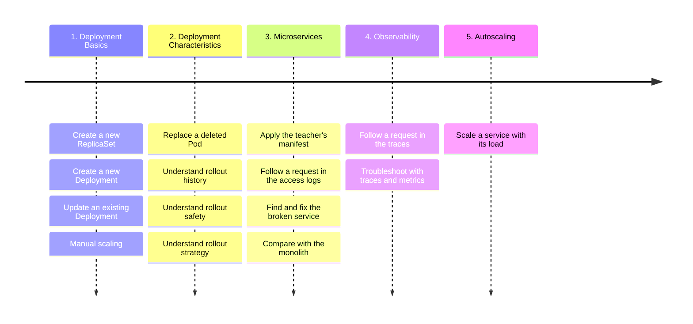

# Kubernetes Deployment

Lab Session 3 - 28 Oct, 2026

## Introduction

The goal of this lab session is to train your skills related to
ReplicaSet and Deployment. It lets you practice the definition,
creation, operations related to these resources, lets you better
understand their characteristics. This session is also a transition
toward a bigger project “Pet Clinic” using a microservice architecture.



Write your answers in this document, where you see `# TODO`. A `# NOTE`
points to another file of your repository, such as a Kubernetes
manifest: write it there, not in this document. Commit and push to the
branch `main`: only `main` counts. Never force-push.

## Before you start - Delete the Pods of Lab 2

The Pods of Lab Session 2 may still run in your cluster: `nginx`,
`spring-petclinic` and `team-info-server`. Delete them, so that this lab
session starts from an empty namespace.

``` sh
kubectl delete pod nginx spring-petclinic team-info-server --ignore-not-found
kubectl get pods
# No resources found in default namespace.
```

  

## Exercise 1 - ReplicaSet

Create a new ReplicaSet with 1 replica and the Docker image that your
team published in Lab Session 1:
`mincongclassroom/spring-petclinic-${team}:1.1.0`, the version with your
team name in the footer (Lab Session 1, Exercise 6). Use labels
`app=spring-petclinic` and `team=${team}` for both the ReplicaSet and
the underlying Pods. The underlying container should use port 8080 to
receive incoming traffic. The container name should be `main` in the
ReplicaSet. You must use the Docker image that you published to Docker
Hub. Persist the Kubernetes manifest (YAML file) in the Git repository
as file `k8s/lab-3/replicaset-petclinic.yaml`.

  

``` sh
# NOTE: write the manifest to file "${REPO_ROOT}/k8s/lab-3/replicaset-petclinic.yaml"
```

  

Now, scale the ReplicaSet to 2 replicas and verify that the operation is
successful.

  

``` sh
# TODO: write down your command and verification here
```

  

Delete one of the Pods from this ReplicaSet, how many Pods do you have
now? Why?

  

``` sh
# TODO: write down your verification and analysis here
```

  

Now, delete the ReplicaSet to free up space on your machine.

  

``` sh
# TODO: write down your command and verification here
```

  

## Exercise 2 - Deployment

Similar to Exercise 1, create a new Deployment with 1 replica using the
same Docker image, `mincongclassroom/spring-petclinic-${team}:1.1.0`.
Use labels `app=spring-petclinic` and `team=${team}` for both the
Deployment and the underlying Pods. The underlying container should use
port 8080 to receive incoming traffic. The container name should be
`main` in the Deployment. Persist the Kubernetes manifest (YAML file) in
the Git repository as file `k8s/lab-3/deployment-petclinic.yaml`.

  

``` sh
# NOTE: write the manifest to file "${REPO_ROOT}/k8s/lab-3/deployment-petclinic.yaml"
```

  

Update the Deployment to include your team name as an environment
variable. The key should be `TEAM`, and the value should be your team
name in lowercase.

Once the change is applied, describe it in a few words. The description
goes to the annotation `kubernetes.io/change-cause` of the Deployment:

``` sh
kubectl annotate deployment/spring-petclinic kubernetes.io/change-cause="Add the environment variable TEAM"
```

Observe the rollout history of the Deployment: how many revisions does
it have, and what does it say about each of them?

  

``` sh
# NOTE: write the manifest to file "${REPO_ROOT}/k8s/lab-3/deployment-petclinic.yaml"
```

``` sh
# TODO: write down your commands and the rollout history here
```

  

Try to disrupt the Deployment by using a Docker image tag that does not
exist, then record the change cause using `kubectl annotate`. What
happens to the Deployment? Consider checking the ReplicaSets related to
this Deployment. Can you access the website from your browser?

  

``` sh
# TODO: write down your analysis
```

  

Can you roll back to the previous version? Observe the rollout history
before and after the rollback: what changed?

  

``` sh
# TODO: write down your commands and your observations here
```

  

## Exercise 3 - Deployment Strategy

When a Deployment rolls out a new version, its strategy says how the
Pods are replaced. So far, your Deployment used the default one. Now,
change it: add the following block to the `spec` of the Deployment, at
the same level as `replicas`, and apply the manifest.

``` yaml
strategy:
  type: RollingUpdate
  rollingUpdate:
    maxSurge: 0%
    maxUnavailable: 100%
```

What do these entries mean? How do they influence the deployment
strategy?

Then, disrupt the Deployment again by using a Docker image tag that does
not exist, and describe this change afterward, as in Exercise 2. What
happens this time? Can you access the website from your browser? Compare
with the previous disruption and explain the difference. Finally, roll
back to the previous version.

  

``` sh
# NOTE: write the strategy to file "${REPO_ROOT}/k8s/lab-3/deployment-petclinic.yaml"
# TODO: write down your commands and your analysis here
```

  

## Exercise 4 - Microservices

Now, the Pet Clinic grows: it is no longer one application, it adopts a
microservice architecture. The API Gateway serves the Web UI and routes
the requests to three services: the Customers Service, the Visits
Service and the Veterinarians Service. Each of them runs as its own
Deployment.

Keep the Deployment `spring-petclinic` of Exercise 3 running: you
compare the two architectures in Exercise 5.

The teacher prepared the manifest of the whole stack. Apply it:

``` sh
kubectl apply -f https://mincong.io/esigelec/lab/3/microservices.yaml
```

Give the stack a minute or two to start, then open the website
(<http://localhost:8080>) in your browser:

``` sh
kubectl port-forward deployment/api-gateway 8080:8080
```

Is the website loaded correctly? Please take a screenshot and store it
in this git repo as file `docs/lab-3/website.png`.

Unfortunately, this manifest has one mistake, and the website is
half-broken. Visit the pages of the website: which ones work, and which
one fails? Don’t consider the page “About” nor the chat box “Chat with
Us!”: they show an error until Lab Sessions 4 and 5.

  

``` sh
# NOTE: store the screenshot as file "${REPO_ROOT}/docs/lab-3/website.png"
# TODO: write down your observations here
```

  

Before you look for the mistake, follow a request through the stack.
Each service writes an **access log**: one line for each HTTP request
that it receives, in the logs of its container. Each of these lines
contains the word `AccessLog`. Based on the access log of each service,
can you determine which service is broken? Please fix it.

To save your answer, store the teacher’s manifest in the Git repository
as file `k8s/lab-3/microservices.yaml`, put your changes there and apply
it. Then go through the whole flow again, and prove that the website is
working well.

  

``` sh
# NOTE: write the fixed manifest to file "${REPO_ROOT}/k8s/lab-3/microservices.yaml"
# TODO: write down your commands, your analysis and your verification here
```

  

## Exercise 5 - Monolith vs Microservices

Now that the whole website works, compare the two architectures of the
Pet Clinic: the monolith and the microservices. Before doing so, install
the observability tools of the Pet Clinic. One of them is the Metrics
Server, an add-on of Kubernetes that measures the CPU and the memory
that each Pod uses; the three others are for Exercise 6. Together, they
take about 500 MB of memory: if your machine runs short of it, tell the
teacher.

``` sh
kubectl apply -f https://mincong.io/esigelec/lab/3/observability.yaml
```

Wait a minute for the first measures.

Then explore the two architectures, and gather the facts that tell them
apart, with how you found each of them. For example: the resources and
the images that each one needs, the memory and the CPU that its Pods
use, the time that an application takes to start, or what the users saw
when an image was broken. Everything is at hand: the manifests, the
access logs, and the commands `kubectl get`, `kubectl describe`,
`kubectl logs` and `kubectl top`.

  

``` sh
# TODO: write down the facts that you gathered, and your analysis
```

  

## Exercise 6 - Microservices Observability

The access logs say what each service received, one service at a time.
**Observability** tools say more: a **trace** follows one request
through all the services, with the time of each step, and the
**metrics** measure the services over time, such as their number of
requests per second. This exercise uses three of these tools, which run
since you applied `observability.yaml` in Exercise 5:

- [Zipkin](https://zipkin.io/) collects the traces that the services
  send.
- [Prometheus](https://prometheus.io/) collects the metrics of the
  services, every 15 seconds.
- [Grafana](https://grafana.com/) draws these metrics in dashboards.

The services do not send their traces yet. In your manifest
`k8s/lab-3/microservices.yaml`, enable them: in the ConfigMap
`petclinic-config`, under `tracing` and `export`, change
`enabled: false` into `enabled: true`. Apply the manifest, then restart
the four PetClinic services, so that they read their new configuration:

``` sh
kubectl rollout restart deployment/api-gateway deployment/customers-service deployment/visits-service deployment/vets-service
```

  

``` sh
# NOTE: write the change to file "${REPO_ROOT}/k8s/lab-3/microservices.yaml"
```

  

Open the UI of Zipkin, at <http://localhost:9411>:

``` sh
kubectl port-forward deployment/tracing-server 9411:9411
```

In the website, open the pages “Find owners” and “Veterinarians” again:
start the port-forward of the API Gateway again first, since the restart
replaced its Pod. Then, in Zipkin, find the trace of each of them: add
the criterion `serviceName` with the “+” of the search bar, choose the
service that answered the page, click “Run Query”, then “Show”. For each
trace: which services took part in the request, how long did it take,
and where was the time spent?

  

``` sh
# TODO: write down your observations here
```

  

Now, create a service outage artificially by stopping the Veterinarians
Service:

``` sh
kubectl scale deployment/vets-service --replicas=0
```

Then, open the page “Veterinarians” again. Find the trace of this
request in Zipkin: add the criterion `tagQuery`, with
`http.url=/api/vet/vets`. What does it tell you? Then open Prometheus,
at <http://localhost:9090>, then the menu “Status”, then “Target
health”: which services does Prometheus monitor, and what is the state
of each of them?

``` sh
kubectl port-forward deployment/prometheus-server 9090:9090
```

Finally, start the Veterinarians Service again:

``` sh
kubectl scale deployment/vets-service --replicas=1
```

  

``` sh
# TODO: write down your commands and your observations here
```

  

Finally, open Grafana, at <http://localhost:3000>, then “Dashboards”,
then “Spring Petclinic Metrics”. Browse the website for a minute: what
does the dashboard show?

``` sh
kubectl port-forward deployment/grafana-server 3000:3000
```

  

``` sh
# TODO: write down your observations here
```

  

## Exercise 7 - Autoscaling

So far, you changed the number of replicas by hand using
`kubectl scale`. But did you know that Kubernetes can also change it for
you, depending on the load? This is the job of a
**HorizontalPodAutoscaler** (HPA).

Create an HPA that runs the Customers Service with a minimum of 1
replica and a maximum of 3 replicas, depending on its CPU. Then send
many requests to this service: does it scale up? Stop them: does it
scale down? No tool is needed to send them: the console of your browser
can do it. Follow the number of Pods of each service in the dashboard of
Grafana, and find in Zipkin which Pod answered a request. How does the
HPA decide the number of replicas?

  

``` sh
# NOTE: write the HPA to file "${REPO_ROOT}/k8s/lab-3/horizontalpodautoscaler-customers-service.yaml"
# TODO: write down your commands, your observations, your analysis and what you learned here
```
